*Учебный полигон Ampire. Сценарий защиты системы автоматизации процессов организации.*

# Цель работы

Изучить процесс мониторинга и расследования инцидентов информационной безопасности в учебной инфраструктуре Ampire. По событиям средств мониторинга и данным операционных систем выявить признаки компрометации веб-сервера GravCMS, сервера PostgreSQL и узла SCADA IGSS32, а также рассмотреть меры реагирования, направленные на локализацию атаки и устранение механизмов закрепления злоумышленника.

# Легенда атаки

Согласно легенде учебного сценария, злоумышленник после разведки сети обнаружил веб-приложение организации и воспользовался уязвимостью внешнего периметра для получения доступа к серверу. Далее он попытался закрепиться в инфраструктуре и получить доступ к критически важным узлам. Задача Blue Team — выявить признаки атаки, определить затронутые узлы, зарегистрировать инциденты и устранить причины успешного выполнения атаки.

В материалах сценария выделены три основных направления:

- **GravCMS:** удалённое выполнение кода и получение доступа к веб-серверу;
- **PostgreSQL:** небезопасная конфигурация СУБД и закрепление через задание `cron`;
- **SCADA IGSS32:** эксплуатация уязвимости сервера IGSS и использование планировщика заданий.

По предоставленным журналам и сетевым событиям в работе встречаются следующие адреса:

| Узел или роль | Адрес и наблюдение |
|---|---|
| Внешний источник активности | `195.239.174.11` |
| Веб-сервер GravCMS | `10.10.1.32`, HTTP/80 |
| Сервер PostgreSQL | `10.10.2.26`, PostgreSQL/5432 |
| Узел, на который направлены события Bind_API | `10.10.3.10` |
| Клиент, отображаемый в IGSSDataServer | `10.10.2.26:19592` |

Адреса и роли приведены по имеющимся скриншотам. Наличие сетевого события само по себе не доказывает успешную эксплуатацию уязвимости: выводы ниже основаны на совокупности сетевых оповещений, содержимого пакетов и признаков на самих узлах.

# Обнаружение и расследование первого этапа: GravCMS

## Анализ событий Security Onion

В общей ленте Security Onion обнаружены события, связанные с подозрительной сетевой активностью. Среди них присутствует сигнатура `ET TROJAN Possible Metasploit Payload Common Construct Bind_API (from server)`, а также события загрузки исполняемых файлов по HTTP и сигнатуры, связанные с удалённым выполнением кода.

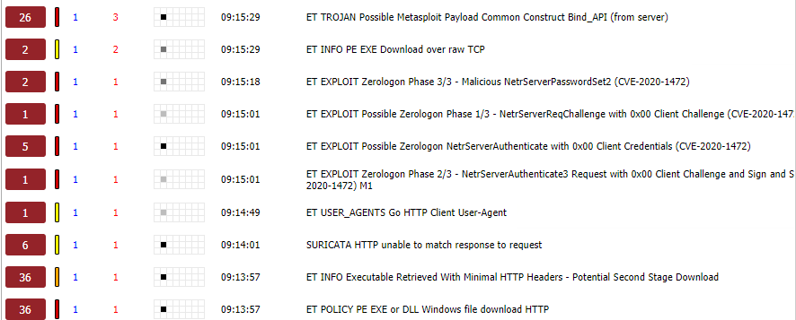{#fig-so-overview width=95%}

При раскрытии события Bind_API отображается внешний источник `195.239.174.11`. Среди адресов назначения в этом наборе событий указаны `10.10.1.253`, `10.10.2.10` и `10.10.1.26`. Данные события требуют сопоставления с журналами соответствующих узлов и не должны автоматически объединяться с каждым последующим этапом атаки.

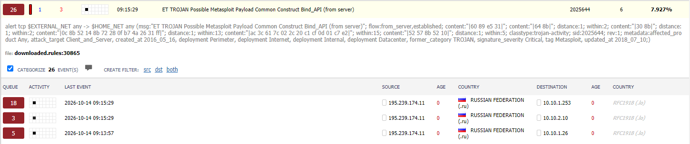{#fig-bind-api-details width=95%}

В той же временной последовательности Security Onion отображает несколько сигнатур Zerologon, относящихся к CVE-2020-1472: запрос `NetrServerReqChallenge`, аутентификацию с нулевыми учётными данными и `NetrServerPasswordSet2`.

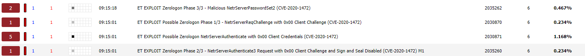{#fig-zerologon-events width=95%}

Раскрытие одной из сигнатур показывает правило обнаружения `ET EXPLOIT Zerologon Phase 3/3 - Malicious NetrServerPasswordSet2`. Эти события следует учитывать как отдельный набор индикаторов и проверять по журналам целевого узла. В основном сценарии материалов Ampire отдельно выделены GravCMS, PostgreSQL и SCADA IGSS32.

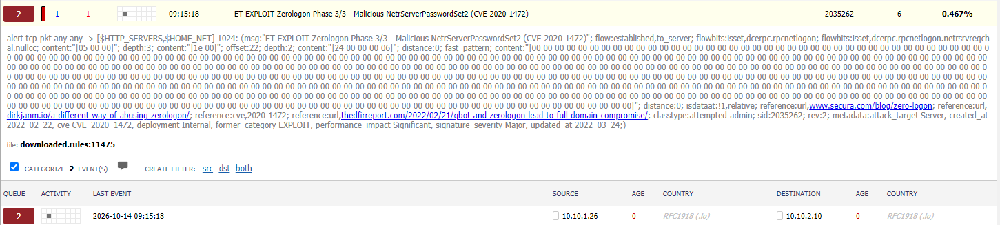{#fig-zerologon-detail width=95%}

Отдельно зафиксированы события `ET USER_AGENTS Go HTTP Client User-Agent` и `ET EXPLOIT php script base64 encoded Remote Code Execution 1`. Последняя сигнатура указывает на HTTP-активность, характерную для попытки передачи PHP-кода в закодированном виде.

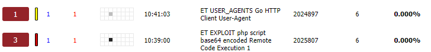{#fig-rce-alerts width=85%}

В деталях события видны обращения с адреса `195.239.174.11` к веб-серверу `10.10.1.32` на порт TCP/80. Для нескольких записей указана сигнатура `ET EXPLOIT php script base64 encoded Remote Code Execution 1`.

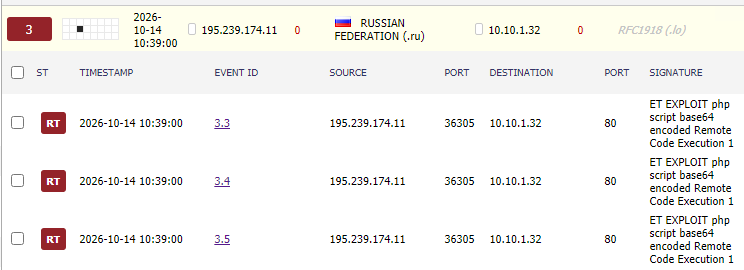{#fig-rce-flow width=95%}

## Анализ HTTP-запроса к GravCMS

В сетевом дампе обнаружен HTTP-запрос:

```http
POST /admin/config/scheduler HTTP/1.1
Host: 195.239.174.104
Content-Type: application/x-www-form-urlencoded
```

В теле запроса присутствуют параметры `custom_jobs` и закодированная полезная нагрузка. Ответ сервера — `HTTP/1.1 200 OK`. Это подтверждает, что веб-сервер обработал запрос и вернул успешный HTTP-статус, однако сам по себе код `200 OK` не доказывает выполнение переданного кода. В совокупности с сигнатурой RCE и последующими признаками на узле запрос рассматривается как индикатор инцидента.

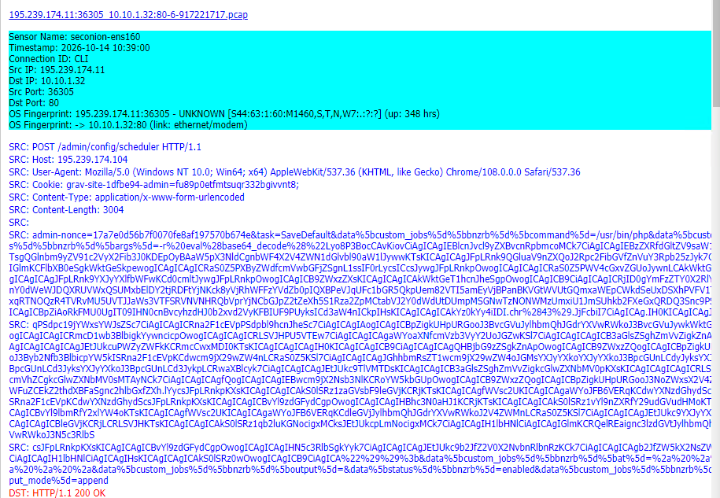{#fig-scheduler-request width=95%}

## Проверка состояния веб-сервера

На узле GravCMS проверено содержимое каталога `/var/spool/cron/` и каталога `crontabs`. В нём присутствуют задания для пользователей `root` и `www-data`. Наличие заданий само по себе не является признаком компрометации, поэтому далее проверено содержимое конкретного файла crontab.

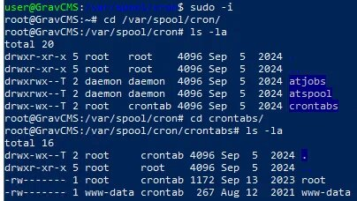{#fig-grav-cron-list width=85%}

В crontab пользователя `root` отображается задание, запускающее архивацию каталога GravCMS с использованием шаблона `*`:

```cron
* * * * * tar -zcf /var/www/html/grav-admin/ && tar -zcf /var/backups/grav_backup.tar *
```

Использование подстановочного символа в команде архивации требует отдельной проверки. В материалах сценария описана уязвимость wildcard injection в связке GravCMS Admin Panel и Cron (CVE-2021-21425). Поэтому данное задание рассматривалось как потенциально опасная точка эксплуатации, а не как безусловное доказательство вредоносности обычного резервного копирования.

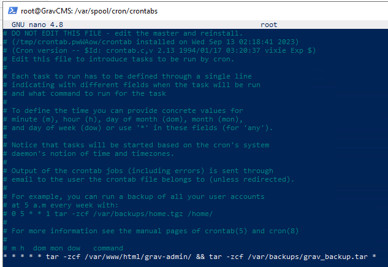{#fig-grav-root-crontab width=95%}

Дополнительно проверена информация об операционной системе. На экране отображается Linux GravCMS с ядром `5.4.0-109-generic` (Ubuntu). Эта информация использовалась для определения конфигурации узла и выбора дальнейших действий по реагированию.

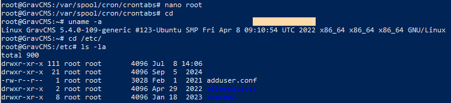{#fig-grav-os width=95%}

# Локализация и устранение последствий на GravCMS

## Ограничение доступа к административному разделу

В конфигурацию виртуального хоста Apache добавлено ограничение доступа к пути `/admin`:

```apache
<Location /admin>
    deny from all
</Location>
```

Такое правило блокирует обращения к административному разделу через данный виртуальный хост. Перед применением подобного ограничения в рабочей системе необходимо учитывать требования к легитимному административному доступу и настроить разрешённые адреса или механизм аутентификации.

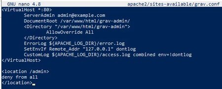{#fig-apache-admin-deny width=90%}

После изменения конфигурации выполнен перезапуск Apache командой `systemctl restart apache2`. Затем проверены активные TCP-соединения командой `ss -tp`. Среди соединений отображается активность процесса `chisel.sh`, связанная с внешним адресом `195.239.174.11`; в терминале показана команда завершения процесса с PID `1514`.

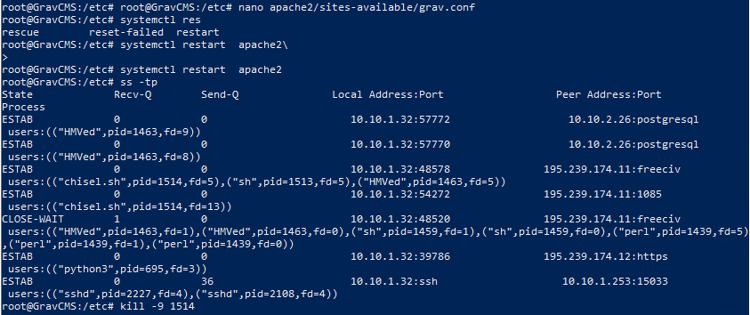{#fig-apache-connections width=95%}

## Удаление подозрительного резервного файла

В каталоге резервных копий GravCMS обнаружен файл `evil_backup--20261014104001.zip`. После удаления файла повторный просмотр каталога показывает оставшуюся штатную резервную копию `default_site_backup--20221128062801.zip`.

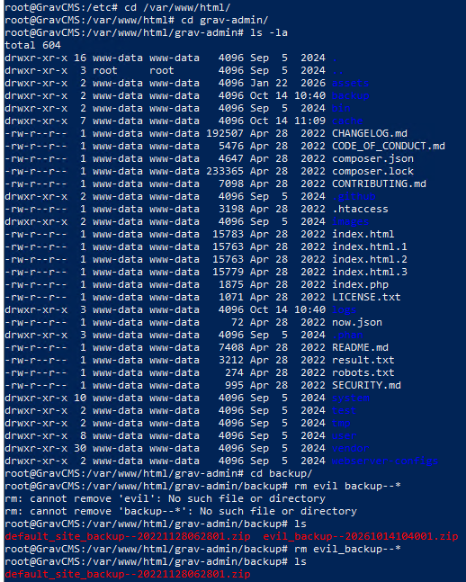{#fig-remove-grav-backup width=95%}

Таким образом, на веб-сервере были выполнены меры по ограничению доступа к административному разделу, перезапуску Apache, завершению подозрительного процесса и удалению обнаруженного файла резервной копии. После реагирования необходимо дополнительно проверить журналы Apache, задания cron и отсутствие повторных внешних соединений.

# Обнаружение и устранение инцидента на PostgreSQL

## Анализ сетевого взаимодействия

В материалах сценария этап PostgreSQL связан с уязвимостями CVE-2019-9193 и CVE-2022-31659. В Security Onion изучен сетевой обмен между `10.10.1.32` и `10.10.2.26:5432`. В запросе присутствует обращение к базе `template1`. В ответе PostgreSQL зафиксировано сообщение:

```text
FATAL: no PostgreSQL user name specified in startup packet
```

Это подтверждает попытку установления соединения с СУБД со стороны веб-сервера. Сообщение об отсутствии имени пользователя указывает на некорректный пакет запуска соединения; по нему одному нельзя сделать вывод об успешной аутентификации.

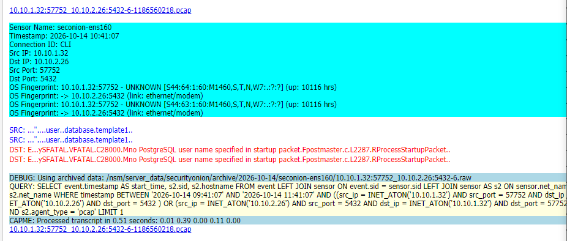{#fig-postgres-packet width=95%}

## Проверка конфигурации PostgreSQL

На сервере `10.10.2.26` проверена версия PostgreSQL — `13.14` (Debian). Основные конфигурационные файлы находятся в каталоге `/etc/postgresql/13/main/`, в том числе `pg_hba.conf` и `postgresql.conf`.

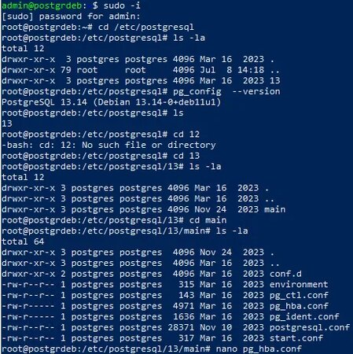{#fig-postgres-config-files width=90%}

В `pg_hba.conf` отображаются правила локального доступа: для Unix-сокета используется метод `peer`, для IPv4- и IPv6-подключений с localhost — `md5`. Также присутствуют правила для репликации. Данный файл определяет, какие пользователи и с каких адресов могут подключаться к СУБД и каким способом выполняется аутентификация.

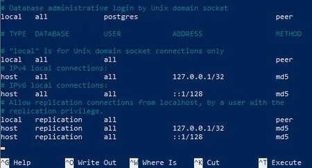{#fig-pg-hba width=90%}

В `postgresql.conf` обнаружен параметр:

```conf
listen_addresses = '*'
```

Значение `*` означает, что PostgreSQL прослушивает все доступные сетевые интерфейсы. Для сервера, которому не требуется принимать подключения со всех интерфейсов, это избыточно расширяет поверхность атаки. Следует ограничить прослушивание localhost или конкретными доверенными адресами и согласовать это ограничение с правилами `pg_hba.conf`.

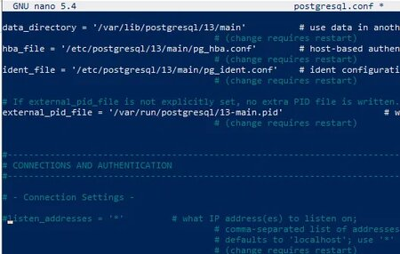{#fig-postgres-listen width=95%}

## Выявление механизма закрепления

В журнале PostgreSQL обнаружены ошибки аутентификации пользователя `postgres`, в том числе сообщения `empty password returned by client` и `password authentication failed for user "postgres"`. В записи указано правило `pg_hba.conf`, по которому обрабатывалось подключение.

В ходе проверки crontab пользователя `postgres` обнаружено задание, запускаемое каждую минуту:

```cron
*/1 * * * * /var/lib/postgresql/evil.conf
```

Задание удалено командой `crontab -r -u postgres`; последующая проверка `crontab -l -u postgres` вернула сообщение `no crontab for postgres`. На скриншоте также зафиксирована попытка смены пароля пользователя `postgres`. Одна из попыток завершилась сообщением о несовпадении введённых значений, поэтому успешную смену пароля необходимо подтвердить отдельной проверкой.

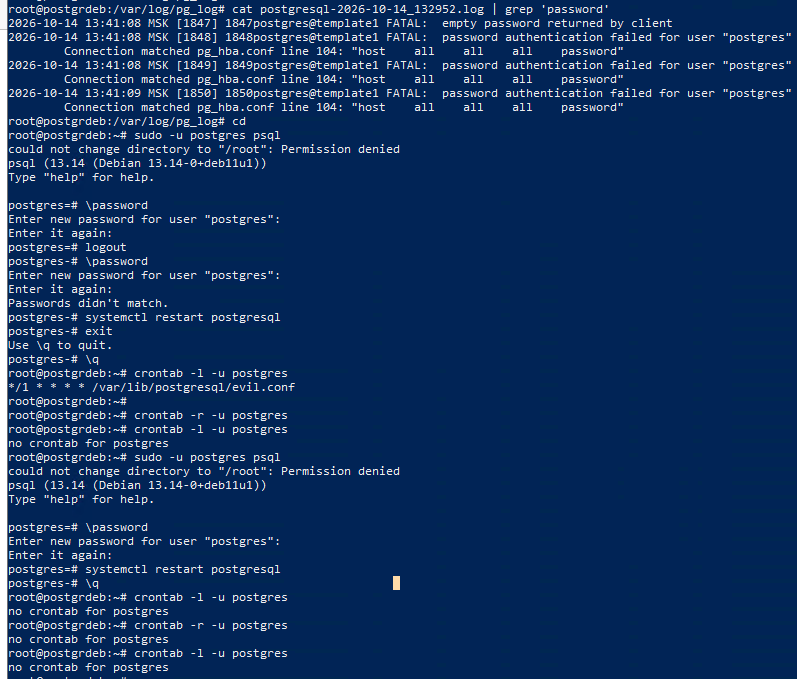{#fig-postgres-cron-password width=95%}

Дополнительная проверка показала наличие файла `/var/lib/postgresql/evil.conf` и процесса с таким именем. В выводе `ss -tp` отображалось соединение от `10.10.2.26` к внешнему адресу `195.239.174.11:7896`, связанное с процессом `evil.conf` (PID `1278`). Файл удалён, задание cron повторно проверено и удалено, после чего процесс завершён командой `kill -9 1278`.

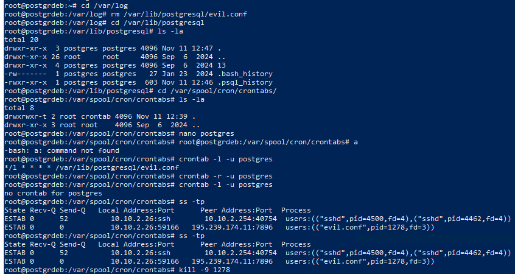{#fig-postgres-cleanup width=95%}

В результате были устранены обнаруженные механизмы автоматического запуска вредоносного файла: удалено задание cron пользователя `postgres`, удалён файл `evil.conf` и завершён связанный с ним процесс. Дополнительно требуется подтвердить изменение пароля и проверить фактическое значение `listen_addresses` после редактирования конфигурации и перезапуска службы.

# Обнаружение и реагирование на инцидент SCADA IGSS32

## Обнаружение сетевой активности

На следующем этапе в Security Onion обнаружено событие `ET TROJAN Possible Metasploit Payload Common Construct Bind_API (from server)`. Источник — `195.239.174.11`; среди адресов назначения присутствует узел `10.10.3.10`. Для события отображается 12 срабатываний. Данная сигнатура указывает на сетевую активность, характерную для полезной нагрузки Metasploit, и требует проверки целевого узла.

В материалах сценария для SCADA IGSS32 описана уязвимость CVE-2011-1567 — переполнение буфера в `IGSSdataServer.exe`. Сетевое событие рассматривается в контексте проверки этого этапа атаки, но само по себе не доказывает успешную эксплуатацию CVE.

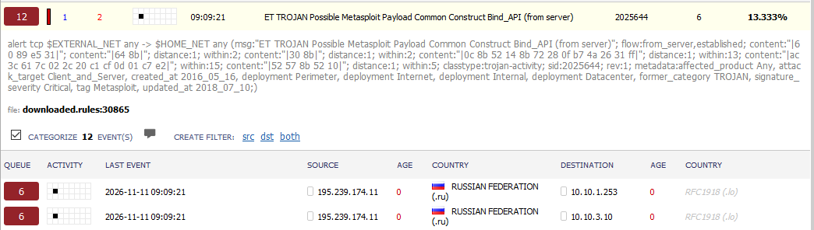{#fig-scada-bind-api width=95%}

## Проверка IGSSDataServer

В окне IGSSDataServer состояние сервера указано как `Running`, количество активных клиентов — 1. В списке активных клиентов отображается адрес `10.10.2.26:19592`. В журнале присутствуют запросы `ListAll`, `Request general file` и `Request ALM`, а также записи об открытии и завершении сессий.

Это подтверждает наличие соединения узла `10.10.2.26` с сервером IGSS и активность запросов к нему. Для оценки последствий необходимо сопоставить эти записи с сетевыми событиями и временем обнаружения атаки.

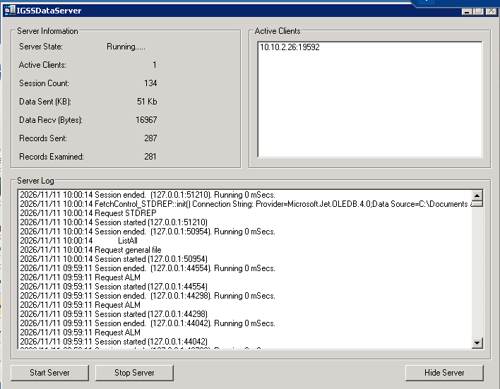{#fig-igss-server-log width=90%}

## Меры реагирования на узле SCADA

В интерфейсе Windows Firewall выбран режим `On (recommended)`, предназначенный для блокирования входящих подключений из внешних источников, кроме явно разрешённых исключений. На снимке при этом остаётся предупреждение `Your PC is not protected: turn on Windows Firewall`, поэтому по одному изображению нельзя подтвердить, что изменение было окончательно применено. После нажатия `OK` необходимо повторно открыть настройки и убедиться, что брандмауэр действительно включён.

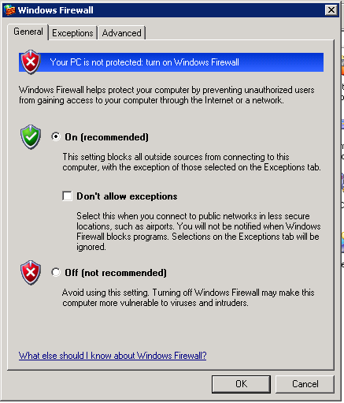{#fig-windows-firewall width=75%}

В оснастке Scheduled Tasks обнаружена задача с именем, начинающимся на `AM_`. В столбце Schedule указано выполнение каждую минуту, а в столбце Status — `Running`. Для задачи открыто контекстное меню и выбран пункт `Delete`. На скриншоте зафиксирован выбор удаления, но итоговое исчезновение задачи после подтверждения не показано; его необходимо проверить повторно.

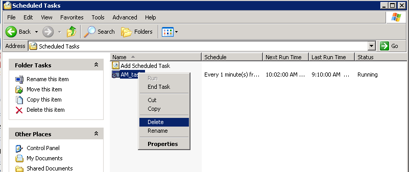{#fig-scheduled-task width=95%}

# Выводы

В ходе лабораторной работы были рассмотрены три направления атаки на учебную инфраструктуру Ampire.

- **GravCMS.** В Security Onion обнаружены события PHP Base64 RCE. В сетевом дампе выявлен POST-запрос к `/admin/config/scheduler` от внешнего адреса `195.239.174.11` к `10.10.1.32:80`. На узле проверены задания cron и активные соединения. Для реагирования ограничен доступ к `/admin`, перезапущен Apache, завершён подозрительный процесс `chisel.sh` и удалён файл `evil_backup`.
- **PostgreSQL.** Обнаружено сетевое взаимодействие `10.10.1.32` с `10.10.2.26:5432`, а в журнале СУБД — ошибки аутентификации пользователя `postgres`. Выявлены широкая настройка `listen_addresses = '*'` и задание cron, запускающее `/var/lib/postgresql/evil.conf`. Задание cron и файл удалены, связанный процесс завершён.
- **SCADA IGSS32.** Обнаружено событие Bind_API от внешнего источника к узлу `10.10.3.10`. В IGSSDataServer зафиксирован активный клиент `10.10.2.26:19592` и запросы к серверу. В Windows Firewall выбран режим включения защиты, а для подозрительной задачи Scheduled Tasks инициировано удаление.

Работа показала, что для расследования инцидента недостаточно одного срабатывания IDS: необходимо сопоставлять сетевые события с пакетами, конфигурациями, журналами и состоянием процессов на конечных узлах.

Для завершения проверки после выполненных действий необходимо подтвердить, что:

- в `postgresql.conf` ограничено значение `listen_addresses`, а служба PostgreSQL перезапущена;
- пароль пользователя `postgres` успешно изменён;
- на узле SCADA Windows Firewall действительно включён;
- подозрительная задача `AM_...` отсутствует в Scheduled Tasks;
- после очистки узлов не появляются повторные соединения с внешним адресом `195.239.174.11`.

Таким образом, в ходе работы были обнаружены признаки компрометации нескольких компонентов инфраструктуры и выполнены основные действия по удалению выявленных механизмов закрепления. Контрольная проверка конфигураций и повторный мониторинг необходимы для подтверждения полного устранения последствий инцидента.

# Использованные материалы

1. Презентация «Киберучения на полигоне Ampire»: легенда и вектор атаки (слайды 5–7), GravCMS и CVE-2021-21425 (слайды 8–25), PostgreSQL (слайды 26–39), SCADA IGSS32 и CVE-2011-1567 (слайды 41–53).
2. Скриншоты событий Security Onion, сетевых дампов и проверки узлов, предоставленные для выполнения лабораторной работы.
